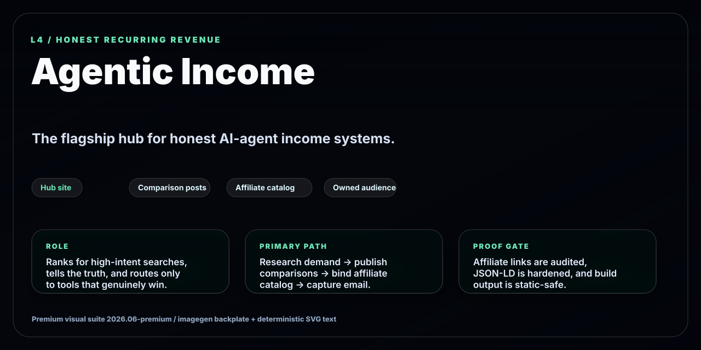

<!-- GITHUB_VISUALS_START -->
<p align="center">
  
</p>

<details open>
<summary><strong>How this repo works</strong></summary>
<p align="center">
  
</p>
</details>

<!-- GITHUB_VISUALS_END -->

# agenticincome.ai

**Flagship of the agentic-income network.** The authority hub on earning with AI agents — honest tool comparisons in the shape AI search engines cite, the exact stacks, and income systems that compound.

Hub-and-spoke: this site is the hub; `agenticpassiveincome.ai` and `disruptivepassiveincome.com` are spokes that cross-link up.

## Stack

Next.js 16 (App Router, Turbopack) · React 19 · Tailwind v4 · MDX (`@next/mdx`). Static-prerendered.

## How it works

- **`lib/site.ts`** — the ONLY brand-specific file. Fork the repo, swap this, ship a spoke.
- **`lib/affiliate.ts`** — binds to the shared catalog (`data/programs.json`, vendored from [`affiliate-agent-skills`](https://github.com/frankxai/affiliate-agent-skills)). `getLink(tool)` returns the affiliate URL or `null` — null renders plain text, never a dead link.
- **`lib/posts.ts`** — curated post registry; content lives in `app/blog/<slug>/page.mdx`.
- **components** — `ComparisonTable` (the sortable conversion table), `AnswerBox` (AEO), `FaqSection` (+FAQPage JSON-LD), `AffiliateLink`, `AffiliateDisclosure`.

## Commands

```bash
pnpm dev               # local
pnpm build             # production build (the guardian gate)
pnpm sync:catalog      # re-vendor the affiliate catalog from the engine repo
pnpm audit:affiliate   # which programs to join + which posts to link (needs engine as sibling)
```

## The loop

Join a program → set `ourLink` in the engine's `data/programs.json` → `pnpm sync:catalog` → every mention across the network goes live. Honest pick always wins; recurring payers over one-time bounties.
