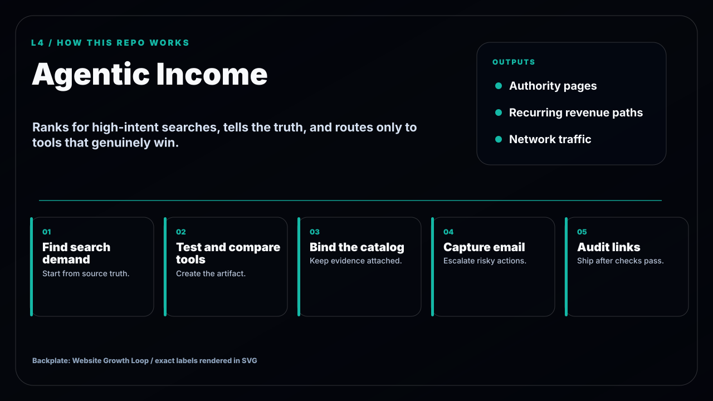
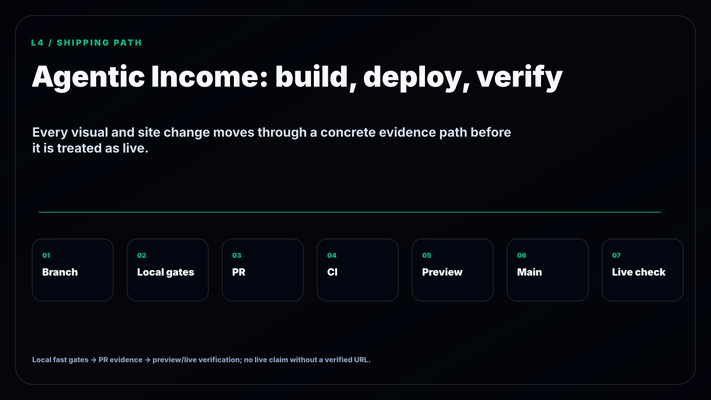

<!-- GITHUB_VISUALS_START -->

  

<strong>How this repo works</strong>

  

<strong>Build, deploy, verify path</strong>

  

<!-- GITHUB_VISUALS_END -->

# agenticincome.ai

**Flagship of the agentic-income network.** Authority hub for honest, citable comparisons of AI tools that pay recurring. Direct products + owned audience + shared engine = income that compounds.

Hub-and-spoke: flagship here; spokes (agenticpassiveincome.com, disruptivepassiveincome.com) use the identical template + one catalog.

## Ground-up 2026 improvements
- Repo-local design operating system in `design/` plus public `/design`
- Vector-first identity source in code; rendered logo images are exploration only
- Coded income desk and flywheel proof components instead of generated text-heavy diagrams
- Premium dark design system (refined glass, stronger hierarchy, hero visuals)
- Direct revenue layer: Starter Kit (free), Blueprint ($67), Private Intel ($19/mo)
- Live /tools catalog + real email capture (stub wired; integrate Systeme/Resend)
- /offers funnel + tracked go. links + flywheel visuals
- AEO-first content shape + llms.txt + rich comparison tables
- Shared engine preserved (data/programs.json + sync)

## Stack
Next.js 16 + React 19 + Tailwind 4 + MDX. pnpm. Static + edge routing via go.

## Core files
- lib/site.ts (brand switch)
- lib/design.ts + design/ (design, motion, taste, evidence)
- data/programs.json (source of truth)
- lib/affiliate.ts + components/ComparisonTable (conversion layer)
- app/blog/* (MDX in citable shape)

## Commands
pnpm dev | build | type-check | sync:catalog | predeploy (gate + sync)

## Business model (evolved)
Affiliate (recurring floor) → owned list → own products (Blueprint/Intel) → engine licensing/consulting. Honesty is non-negotiable; only link winners.

## Trinity Income Portfolio Integration (Earn Stage)
This is the canonical **Earn** stage of the Trinity Income Portfolio (Earn / Automate / Compound).
- **Branding**: Trinity router, Explorer → Shaper stage progression, exportable skills (agentic-passive-income, trinity-income-router).
- **Marketplace Mechanics Absorbed**: Full retainer marketplace UI for $2-5k/mo Agentic Agency plays (manager agents, DePIN, MCP integration).
- **Public-Trust Proofs**: Every recommendation, stage, and retainer includes verifiable proofs published on /trust and discovery hub.
- **Lead Magnet**: Upgraded 7-Day Challenge as evergreen onboarding.
- **Discovery Hub & Onboarding Wizard**: Interactive progression with exportable artifacts.
- All changes production e2e, excellence reviewed, pushed to main.

See /onboarding, /discovery, /marketplace for live implementation.
