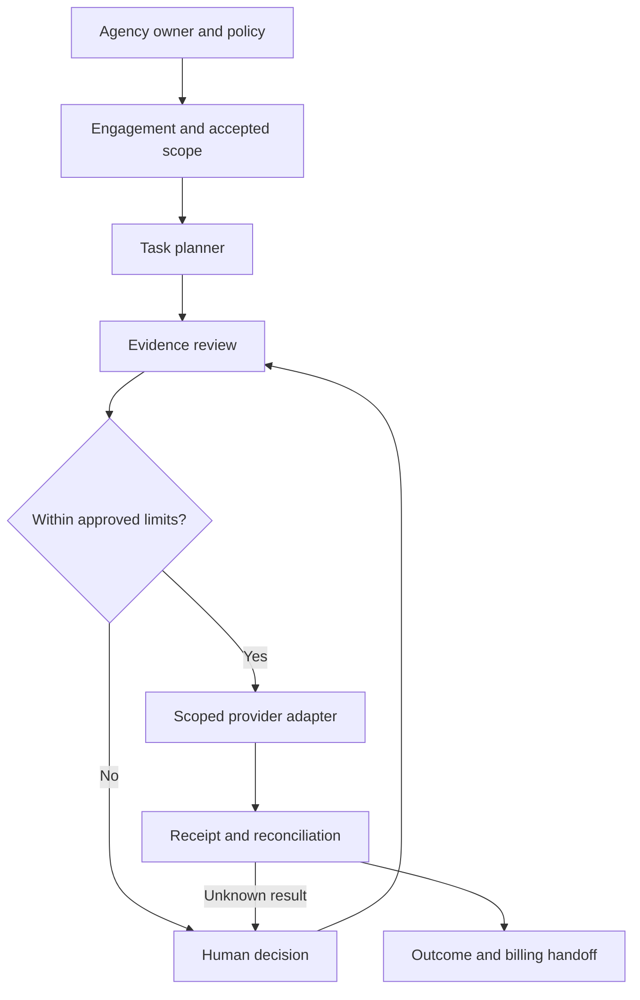

# Architecture choices and connector qualification

Four templates share one agency service contract. Preserve the client's incumbent systems when they meet the required scope. Adding an MCP server does not make a process autonomous, reliable or authorized.

| Template | Choose when | System of record | Maximum proposed level |
| --- | --- | --- | --- |
| Portable agency | Proving a first service | Existing ATS and documents | A1 |
| Connected agency | Repeated delivery within one agency | Incumbent ATS, task workspace and finance system | A3 |
| Retreat and team studio | Adding offsites and team follow-through | Existing Retreat OS for event state; ATS/finance retain their records | A3 |
| Managed agency network | Independent adopters justify maintained infrastructure | Separate tenant records, credentials and authorization | A4 after validation |

Only the local configuration, assessment and offer software is implemented in this package. Connected templates are specifications. No hosted agent service, live ATS connection or shared multi-tenant database is supplied.

The diagram is the target execution architecture. The included engine produces plans for it; it does not run that network.

## Agent responsibilities

Use six bounded task roles: knowledge curator, talent coordinator, evidence reviewer, delivery coordinator, finance preparer and practice facilitator. They share only the authorized engagement packet. The reviewer compares outputs to sources and may reject them; it cannot grant itself source access or approval authority. The human practice role assists a qualified practitioner and does not simulate a therapist.

A task includes tenant, engagement, source revision, input references, expected artifact, acceptance test, allowed tools, cost/time limit, accountable owner and output destination. A coordinator schedules eligible tasks and surfaces exceptions. A dedicated worker handles retries; the chat history is not the durable event store. Prefer a modular service with explicit adapters to a separate autonomous system for every role.

## Current primary-source research

Checked 10 September 2026. Provider documentation is capability evidence, not evidence of hiring performance or authorization in our accounts. All providers below remain unconnected in this product.

| Provider | Documented useful surface | Selection consequence / unresolved qualification |
| --- | --- | --- |
| Recruit CRM | OAuth MCP with role-based access to recruiting records and supported updates | Evaluate for an agency already using it; verify write audit detail, exact tool permissions and readback in a test tenant. [Official MCP page](https://recruitcrm.io/recruit-crm-mcp/) |
| Ashby | MCP for supported recruiting queries and actions using existing permissions | Prefer incumbent Ashby when suitable; test exact role and stage-change scope. [Official update](https://www.ashbyhq.com/product-updates/mcp) |
| Metaview | Role-specific screening with preview, recording, transcript and rubric; human final decisions | Evaluate optional disclosed screening against a reviewed role task. Assess accessibility, alternate route, data handling and unnecessary inference features. No public MCP endpoint verified. [Screening](https://www.metaview.ai/screening) |
| Clay | Official agent plugins, CLI and MCP tools for research and enrichment | Use for permitted client/company research first. Enrichment does not establish permission to contact a person. [Official repository](https://github.com/clay-run/agent-plugins) |
| n8n | MCP discovery and interaction with explicitly exposed workflows | Version-dependent permissions need testing. Documentation distinguishes client tool permissions from workflow visibility; do not assume per-client workflow isolation. [Official documentation](https://docs.n8n.io/connect/connect-to-n8n-mcp-server) |
| Temporal | Durable execution patterns for AI workflows | Evaluate when long waits, retries and recoverable state justify the operating complexity. It is not an HR source of truth or an authorization system. [Official documentation](https://docs.temporal.io/ai) |

Choose one orchestrator per deployment. Start with existing approved tools and add a provider only for a measurable gap. Do not subscribe to every item in the table. No vendor price is embedded as a verified cost; calculator tool allowances are synthetic.

## Connector contract before activating writes

1. Identify exact provider, API/MCP version, tenant and user role. Discover actual tool names; never infer them from marketing labels.
2. Separate record access from action permission. Test unauthorized tenant, forbidden field and expired credential failures.
3. Normalize entity IDs using tenant and provider namespaces. Source records remain authoritative; copy only necessary references and artifacts.
4. Bind approval to payload digest, source version, recipient/resource, amount/currency where relevant, expiry and authenticated actor. Models cannot mint approvals.
5. Give each action a persistent idempotency key. Store attempted, confirmed, failed and unknown outcomes separately. On timeout after a possible success, query by action/provider ID before retrying.
6. Verify webhook signatures, tenant mapping, replay windows and duplicate-event handling. Read back mutations and compare intended and observed fields.
7. Exercise pause/revoke, source deletion, downstream retention and recovery before increasing autonomy. Track vendor/model changes as new evaluation work.

MCP authorization needs tokens issued for the appropriate resource and server-side controls; tool descriptions are not enforcement. See [MCP security guidance](https://modelcontextprotocol.io/specification/draft/basic/security_best_practices).

The delivery team must assess the actual jurisdiction and employment use. EU employment-related uses appear in [AI Act Annex III](https://ai-act-service-desk.ec.europa.eu/en/ai-act/annex-3); this package supplies no legal classification or compliance certification. Do not infer personality, mental health, emotions or spiritual alignment from candidate media or personal disclosures.

## Knowledge architecture

Use separate access classes for agency public methods, agency internal operations, client confidential work, candidate records and participant-private material. Each record needs source owner, access purpose, revision, expiry and retention owner. Candidate lists are evidence with context and freshness, not an unrestricted outreach asset. Keep clinical notes outside the HR operating knowledge base.

Connect the existing Ana invoice work at an accepted milestone and a reviewed billing revision. Connect Retreat OS at event identity, accepted outcomes, cost allocation and task handoff. Preserve upstream booking, payment and clinical records in their authoritative systems. Reuse the [IncomeSystem mapping](06-ARCHITECTURE-AND-REUSE.md); these are adapter specifications, not a competing enterprise schema.
